# RIVR Hotel ERP — Premium UI/UX Implementation Report

**Date:** 9 November 2026  
**Scope:** Frontend UI/UX, styling, animation, and interaction only  
**Status:** Implemented and verified against the running frontend + API with seeded demo data

---

## 1. Original frontend assessment

RIVR was already a working React 19 + Vite application with a clear separation between the public hotel site, authentication, guest portal, role dashboards, and the `/admin` workspace. Functionality, routing, permissions, and API integration were in place. The visual layer, however, still read as a generic admin template:

- Indigo/teal variables and shadows remained from an earlier brand direction, while the product brief called for midnight, ivory, and champagne.
- Public pages had good editorial copy but flat surfaces, raw image blocks, and heroes whose image column could collapse to its intrinsic height.
- GSAP was installed but unused. Motion (Framer Motion 12) handled small reveals only.
- The admin shell worked, but the desktop sidebar scrolled away with long pages, the top bar repeated the page greeting, and KPI cards stacked one-per-row on phones.
- Tables, charts, modals, and buttons had inconsistent visual weight.
- There was no deliberate reduced-motion strategy for scroll animation and no bespoke cursor treatment.

The transformation therefore built on the existing component architecture instead of replacing pages. All forms, tables, filters, route guards, API calls, and permission checks were preserved.

---

## 2. Design system implemented

### Palette

Semantic CSS variable names were kept so existing components did not need a risky rename pass.

| Role | Light | Dark |
| --- | --- | --- |
| Canvas | warm ivory `#f4f1ea` | near-black midnight `#070b12` |
| Ink / text | navy `#111a2a` / `#26303f` | warm ivory `#f4efe5` / `#e3ded3` |
| Primary action | deep navy `#16243b` | slate navy `#2c4768` |
| Accent | muted champagne `#c2a36b` | champagne `#d6b77d` |
| Secondary accent | sage `#3f6b5b` | sage `#7fbfa8` |
| Surfaces | translucent ivory glass over warm canvas | translucent midnight glass |
| Borders | warm grey hairlines | cool light hairlines |

- `--violet` was retuned to a muted teal-slate (`#4f6d74`, dark `#9fc3c9`) so legacy admin highlights harmonise with sage and champagne instead of reading purple.
- Indigo hardcoded focus, chart, and submit shadows were replaced with champagne/navy equivalents.
- Gold is reserved for accents, rules, active indicators, and focus. Primary buttons remain navy for contrast.

### Typography

- Display: **Cormorant Garamond** for editorial headings and numeric KPIs.
- UI: **Manrope** for navigation, forms, tables, and body copy.
- Tight display tracking, generous line-height for body copy, tabular numerals for money and metrics.

### Surfaces and depth

- Glass is selective: public navigation, hero overlays, auth image panel, admin page header, selected cards, modals, and floating elements.
- `@supports not (backdrop-filter…)` provides solid `--elevated` fallbacks.
- Fine one-pixel borders, soft warm shadows, consistent radii (`1.15rem`–`2rem`), and a subtle grain overlay.
- `.lux-card`, `.glass-card`, `.admin-main` table rules, `.metric-card`, `.corner-mark`, and `.image-frame` provide reusable polish without redesigning every page.

### Interaction tokens

- Visible `:focus-visible` ring in champagne.
- Button sheen on primary CTAs.
- Card lift limited to hover-capable pointers.
- Reduced-motion overrides globally shorten animations and disable smooth scrolling.

---

## 3. GSAP animations implemented

GSAP 3.15.1 was already installed. No `@gsap/react` package was added; a small React wrapper uses `useLayoutEffect`.

**`src/components/motion/gsap.ts`**
- Registers `ScrollTrigger` once.
- Wraps setup in `gsap.context(setup, scope)`.
- Calls `context.revert()` on unmount/dependency change.
- Refreshes ScrollTrigger once after layout.
- Skips setup entirely when `prefers-reduced-motion` is set.

**Homepage hero**
- One timeline coordinates eyebrow, two masked title lines, copy, CTAs, trust line, floating notes, image clip-path reveal, and image scale.
- Scroll-linked image drift is GSAP-only; no Motion component animates the same image transform.
- Mobile retains a stacked editorial hero with the image below the copy.

**`PageHero`**
- Shared GSAP opener for Rooms, Amenities, About, Contact, Stay, and other guest pages.
- Masked title reveal, image clip reveal, slow scale settle, and scroll parallax.
- Section is scoped with `gsap.context`, so route changes clean up every trigger.

**`GsapImage`**
- Clip-path entrance triggered once on scroll.
- Optional gentle parallax, disabled where the image sits in a small card.
- Used for editorial images and offers; fixed-size image frames prevent layout shift.

**Auth imagery**
- The split-screen auth shell reveals its photograph and brand copy with a scoped timeline.

**Separation rule:** GSAP owns hero/image clip-path, scale, and scroll-linked drift. Motion owns component opacity/y entrances, layout transitions, and number interpolation. No element has both libraries targeting the same transform properties.

---

## 4. Framer Motion animations implemented

Motion 12 is used for component-level behaviour:

- Root route opacity transition on pathname change.
- `Reveal` entrances for public sections and cards.
- `motion.article` lift on room cards.
- Notice and form-feedback entrances/exits via `AnimatePresence` in the guest portal.
- `AnimatedNumber` uses motion values and `useTransform` so KPI digits animate without re-rendering every frame; it jumps directly to the value under reduced motion.
- Sidebar and mobile navigation transition on width/transform.
- Modal entry is handled by a CSS keyframe (`.modal-panel`) rather than a second JS animation system.
- Charts use CSS `bar-rise` with transform origins; no JS layout animation.

---

## 5. Cursor interaction implementation

`src/components/motion/CustomCursor.tsx`

- Small champagne dot plus a spring-following ring.
- Grows over links, buttons, inputs, selects, textareas, and elements with `data-cursor`.
- Optional short label on image/CTA targets (`RIVR`, `Explore`, `Our story`, `Check dates`, `Confirm`).
- Uses fixed positioning and transforms only.
- **Native cursor is never hidden**, so selection, clicking, and accessibility remain intact.
- Disabled on coarse pointers, when reduced motion is requested, and throughout the staff workspace.
- Event listeners are removed on unmount.
- Verified with an emulated touch/coarse device: the cursor component is not mounted (`present: false`, `coarse: true`).

A 2px champagne scroll progress line is mounted only on guest-facing routes and is also disabled for reduced motion and staff pages.

---

## 6. Image animation implementation

- Hero and page-hero images fill their grid cells and use `object-cover` with configurable focal position; photographs are not stretched.
- Clip-path reveals (`inset`) and subtle scale (1.10–1.18 settling to 1) create a cinematic entrance without blur or quality loss.
- Room cards and room-type cards keep a fixed image ratio, add a gradient scrim, a slow hover zoom, and a fine inner border on hover-capable devices.
- Editorial images use `GsapImage` with scroll-triggered reveal and optional parallax.
- Auth imagery uses the same reveal language.
- Off-screen images use `loading="lazy"`; hero and priority editorial images use eager loading and `fetchPriority="high"`.
- Fixed image frames and background surfaces prevent layout shift while photographs load.

A real bug found during screenshot review was fixed: `.image-frame { position: relative }` overrode the `absolute inset-0` on both heroes, collapsing the image to its intrinsic height and leaving a large navy void. Removing the conflicting position rule lets the image fill the hero cell; the screenshot set reflects the corrected layout.

---

## 7. Admin dashboard improvements

### Shell

- Desktop sidebar is now sticky at `100vh`, so navigation and the role card stay visible while long dashboards scroll.
- Sidebar collapse/expand remains component state only; nothing new is persisted beyond the existing `rivr-theme` convention.
- Mobile drawer, overlay, focus states, skip link, and route-close behaviour preserved.
- Permission-based navigation filtering unchanged. No unauthorized links were exposed.
- Top bar no longer duplicates the page greeting. It carries the workspace breadcrumb, reservation search, quick action, operational alert count, theme toggle, avatar, role label, and sign-out.
- Active sidebar state uses a champagne bar and subtle raised surface.

### Overview

- Real KPI cards only: total rooms, available rooms, occupied rooms, today's arrivals, total reservations, guest profiles, revenue this month, pending payments, and rooms to clean.
- Values come from the existing bootstrap/report data. No demo values were hardcoded.
- KPI numbers animate only when the real value changes; reduced motion shows the final value immediately.
- On phones the KPI grid is two-up with tightened typography, so long INR values fit without overflow.
- Quick actions, alert rows, panel headers, occupancy ring, revenue chart, today's operations, and recent reservations were restyled.
- Chart bars animate with transforms; the occupancy ring is an animated SVG. Both reflect real API values and handle zero/empty data without invented series.
- Tables, filters, badges, row actions, and pagination remain the existing working controls; global admin table styling adds hairline dividers, hover rows, and readable header tracking.

### Role workspaces

All six staff landing experiences were rendered and checked:

| Role | Landing route | Result |
| --- | --- | --- |
| Manager | `/manager/dashboard` | Full overview, real KPIs |
| Receptionist | `/reception/dashboard` | Front desk / arrivals & departures |
| Housekeeping | `/housekeeping/dashboard` | Housekeeping board |
| Accountant | `/admin/reports` | Reports & analytics |
| Restaurant | `/admin/restaurant` | Restaurant & services |
| Staff | `/staff/dashboard` | Restricted operational counts |
| Super admin | `/admin/dashboard` | Full workspace |

Authorization remains enforced by the existing backend and route guards; no permission logic was edited.

---

## 8. Customer portal improvements

- Guest dashboard uses only existing API data:
  - Upcoming stays count, nights booked, outstanding balance, and total stays are derived from the guest's reservations and invoices.
  - Animated welcome band, upcoming-stay timeline, reservation history, invoice table, and profile form.
  - Status badges and notices use the shared design language.
  - `AnimatePresence` handles profile/notice feedback.
- Booking page:
  - Guest details panel now uses the glass surface and display heading.
  - Room summary is sticky on desktop and keeps the live availability warning.
  - Focus states use champagne; submit CTA has the shared sheen.
  - All validation, Indian phone/PIN checks, tax preview, and reservation submission behaviour is unchanged.
- Booking success:
  - Guards against a missing `bookingId` instead of requesting `/public/reservations/` and logging a 404.
  - Existing confirmation, calendar download, and copy-reference actions preserved.
- My bookings lookup:
  - Glass search panel and premium result cards.
  - Lookup endpoint, ownership restrictions, status badges, and “view confirmation” links unchanged.
- Public pages:
  - Premium glass header, editorial footer, PageHero, room cards, offer imagery, and a consistent champagne focus language.
  - Only real catalog values are displayed. `hotelInfo` remains clearly placeholder contact data where the project marks it as such.

---

## 9. Responsive testing results

Verified at:

- Desktop: **1440 × 900**
- Laptop: **1280 × 800**
- Tablet: **768 × 1024**
- Mobile: **390 × 844**

Results:

- **77 route/viewport checks** across public, auth, customer, admin, and role dashboards.
- **0 horizontal-overflow findings** (`document.scrollWidth === window.innerWidth` at every check).
- **0 unexpected console or page errors.** Signed-out `/auth/me` returns the expected 401.
- All checked pages expose a visible `h1`.
- Admin KPI cards are two-up on mobile; tables and filters remain contained.
- Admin desktop sidebar remains pinned while content scrolls; mobile drawer is fixed and dismissible.
- Auth split screen collapses cleanly; booking form and sticky summary remain within the viewport.
- Room filter interaction was exercised: **8 room styles → 5** for “Sleeps 3+”.
- Login → admin dashboard → sign-out returns to `/login` successfully.

Screenshots:

### Homepage — desktop, corrected full-height hero
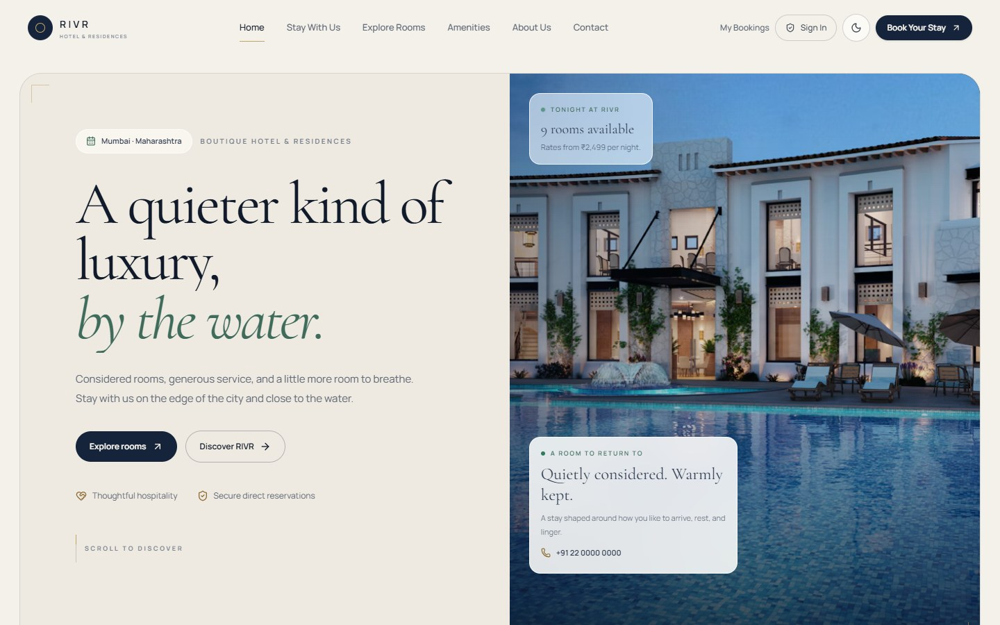

### Homepage — mobile
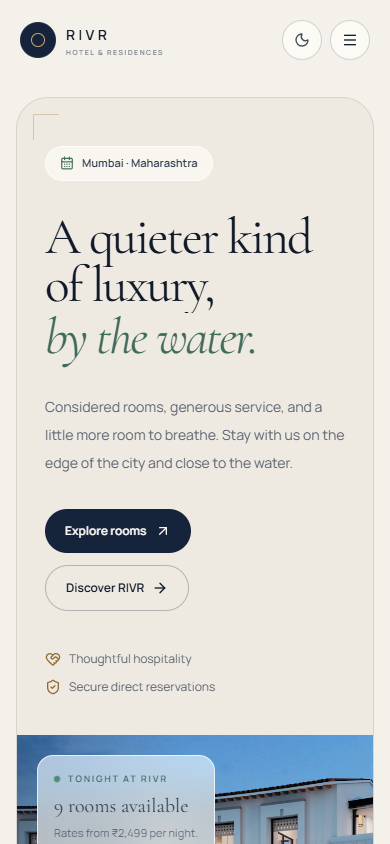

### Homepage — dark theme
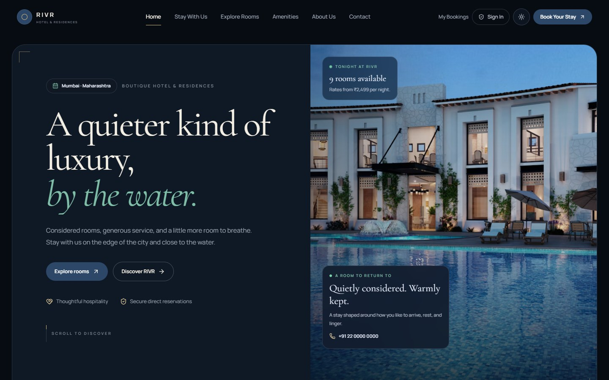

### Rooms
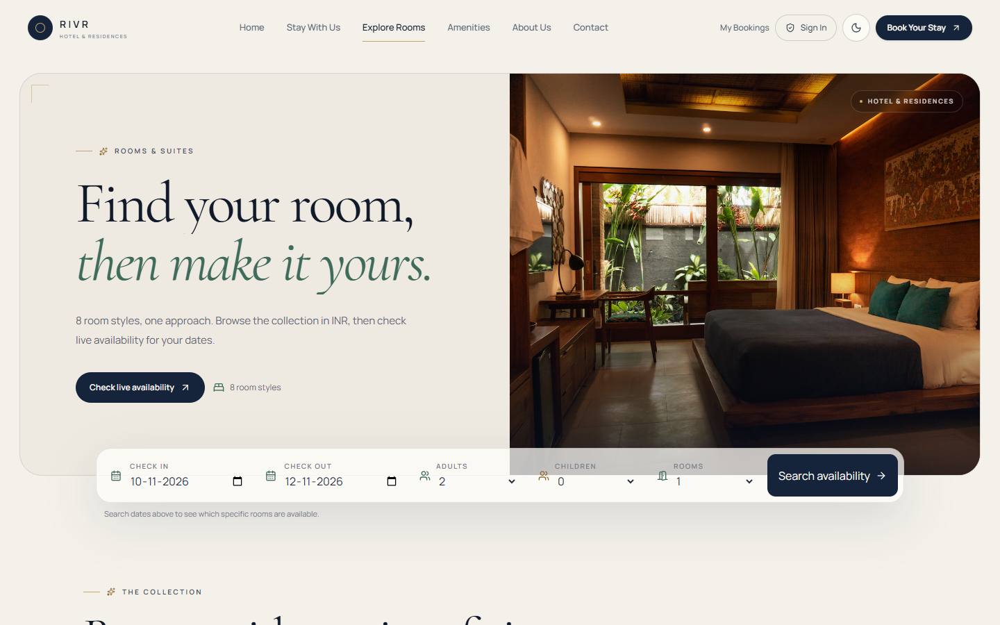

### Authentication
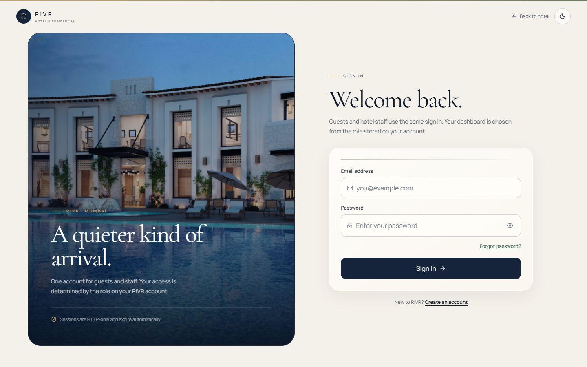

### Booking
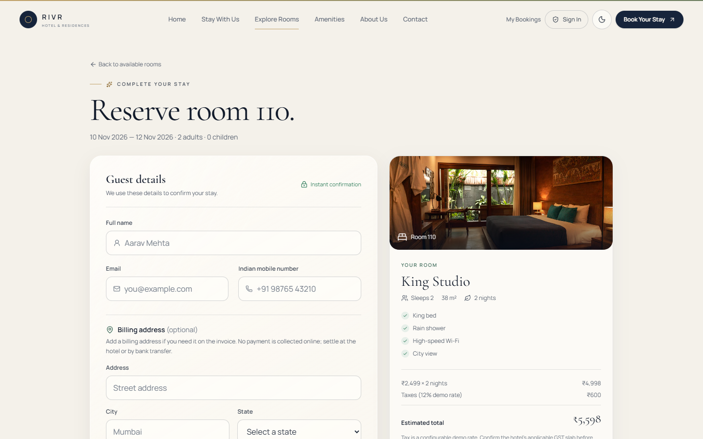

### My bookings lookup
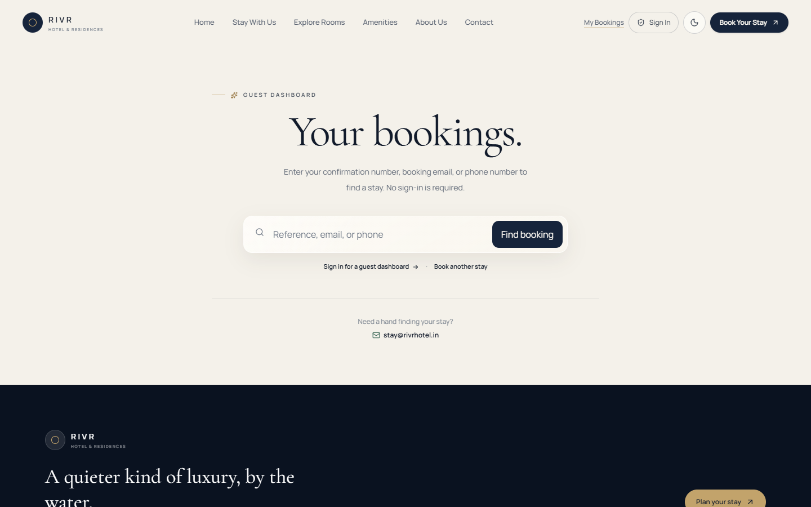

### Admin overview
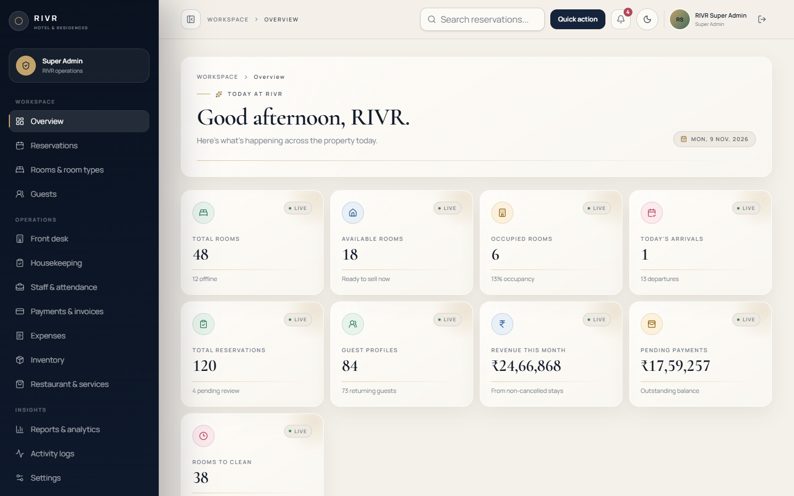

### Admin overview — lower charts and actions
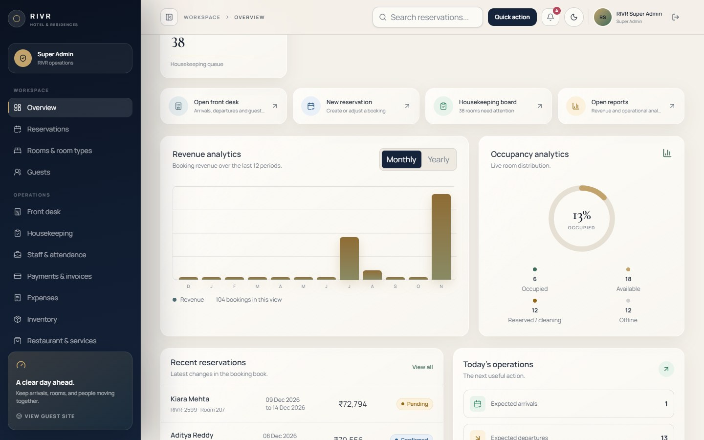

### Admin — mobile KPI layout
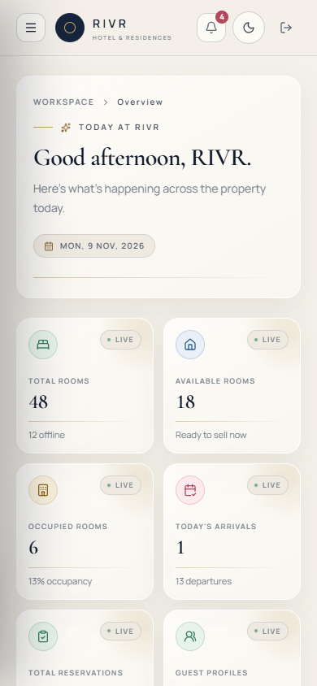

### Admin reservations
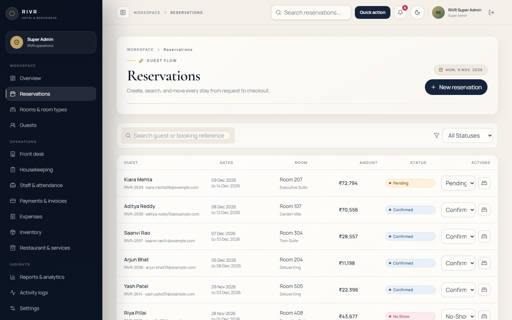

### Guest dashboard
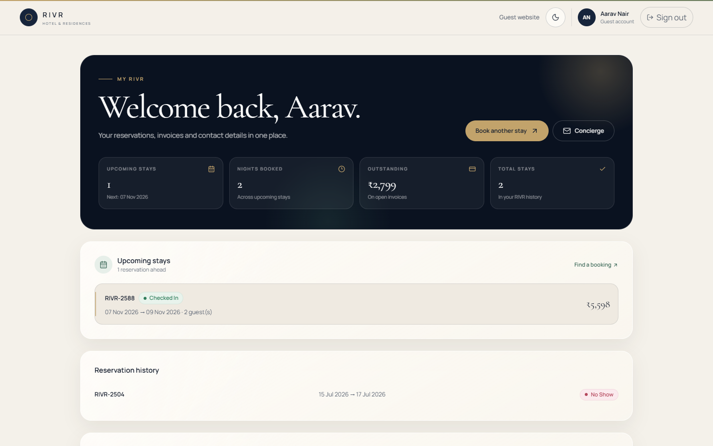

### Reduced motion
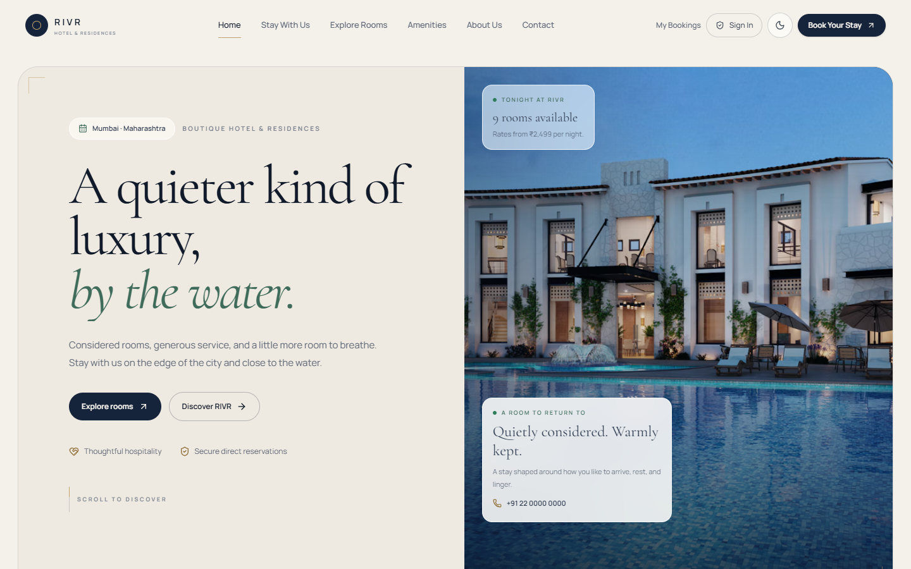

Raw route results and console log are in `reports/screenshots/route-check.json` and `reports/screenshots/console-errors.json`.

---

## 10. Performance testing results

### Build output

Before code splitting, the production build emitted a single **982.38 kB** JS bundle (**279.16 kB gzip**). After route-level lazy loading:

| Eager chunk | Raw | Gzip |
| --- | --- | --- |
| `index` | 310.70 kB | 93.27 kB |
| `HotelUi` shared | 309.51 kB | 99.34 kB |
| `gsap` | 113.71 kB | 44.66 kB |
| **Eager total** | **≈733.9 kB** | **≈237.3 kB** |

Deferred on demand:

- `AdminPages` — 126.05 kB / 24.07 kB gzip
- `AuthPages` — 21.76 kB / 5.49 kB gzip
- `GuestDashboardPage` — 16.38 kB / 4.50 kB gzip
- `BookingPage` — 15.07 kB / 3.73 kB gzip
- Other public pages and shared card/booking chunks

This removes roughly **25% of eager JS** and keeps the entire admin workspace and auth pages out of the initial public download. The build no longer reports a >500 kB chunk warning.

### Runtime approach

- Animation is limited to transform, opacity, clip-path, and SVG stroke properties.
- GSAP contexts and ScrollTriggers are reverted on unmount.
- Motion event listeners are removed on unmount; animated numbers stop their controls on cleanup.
- Route-level code splitting is enabled with TanStack Router `lazyRouteComponent`; `defaultPreload: "intent"` is preserved.
- Images use fixed frames, `object-cover`, lazy loading below the fold, and eager loading only for priority images.
- `prefers-reduced-motion` disables smooth scrolling, shortens CSS animation/transition durations, skips GSAP setup, returns `null` for the custom cursor/progress bar, and snaps animated numbers to their real values.

No Lighthouse or React Profiler run was performed, so no FPS or LCP claim is made. The measured evidence is the production build output, route split, and the absence of layout overflow or console errors in the crawler.

---

## 11. Files changed

All changes are frontend-only unless noted.

| File | Purpose |
| --- | --- |
| `src/index.css` | Retuned light/dark luxury palette; glass, grain, focus, table, card, chart, sidebar, cursor, scroll progress, modal, motion, fallback, print, and reduced-motion styles |
| `src/App.tsx` | Cursor/progress removed from outside router context |
| `src/router.tsx` | Mounted motion utilities inside the root route; lazy-loaded admin, auth, customer, booking, and secondary public routes |
| `src/components/motion/gsap.ts` | Scoped GSAP + ScrollTrigger lifecycle hook |
| `src/components/motion/GsapImage.tsx` | Clip-path reveal and optional parallax image |
| `src/components/motion/AnimatedNumber.tsx` | Motion-value KPI interpolation |
| `src/components/motion/ScrollProgress.tsx` | Guest-only champagne scroll line |
| `src/components/motion/CustomCursor.tsx` | Fine-pointer cursor follower with labels |
| `src/components/hotel/HotelUi.tsx` | Brand mark, compact variant, badges, cards, metric card, feature/empty states, live indicator |
| `src/components/hotel/PageHero.tsx` | GSAP page opener and corrected full-height image |
| `src/components/hotel/PublicChrome.tsx` | Glass public header and dark editorial footer |
| `src/components/hotel/RoomCard.tsx` | Premium room card presentation and hover |
| `src/components/hotel/RoomTypeCard.tsx` | Premium room-type card presentation |
| `src/components/hotel/StaffChrome.tsx` | Sticky/collapsible admin sidebar, mobile drawer, breadcrumbs, header, restricted/error states |
| `src/pages/HomePage.tsx` | Cinematic GSAP hero, editorial sections, offer cards, accessibility spacing |
| `src/pages/AuthPages.tsx` | Premium split-screen auth shell and focus/validation styling |
| `src/pages/GuestDashboardPage.tsx` | Guest portal redesign using real derived metrics |
| `src/pages/AdminPages.tsx` | KPI grid, occupancy ring, charts, quick actions, panels, tables, modals, page-header system, h1 semantics, salutation |
| `src/pages/BookingPage.tsx` | Glass guest form, sticky summary, focus and CTA polish |
| `src/pages/BookingSuccessPage.tsx` | Missing-booking guard (no empty lookup request) |
| `src/pages/MyBookingsPage.tsx` | Glass lookup and result cards |
| `src/pages/RoomsPage.tsx` | Dynamic room-style count copy |
| `reports/RIVR_UI_UX_IMPLEMENTATION_REPORT.md` | This report |
| `reports/screenshots/` | Browser evidence and route-check output |

**Not modified by this task:** backend routes, services, schema, migrations, authentication, authorization, RBAC, database records, payment logic, and security middleware. The pre-existing modified backend files in the working tree were left untouched.

---

## 12. Dependencies added or modified

**None.**

- GSAP `3.15.1` was already installed and is now used.
- Motion `12.43.0` was already installed and remains the component-animation layer.
- No `@gsap/react` or other animation package was added.
- No package manager files were changed by this task.

---

## 13. Existing functionality verified

| Check | Result |
| --- | --- |
| Frontend typecheck (`pnpm exec tsc -b`) | Pass |
| Production build (`pnpm build`) | Pass; no >500 kB chunk warning |
| Public + auth + customer + admin route crawl | 77 checks, 0 issues |
| Login (super admin) | Pass |
| Login (customer) | Pass |
| Logout | Pass, returns to `/login` |
| Role dashboards | Manager, reception, housekeeping, accountant, restaurant, staff all rendered with correct headings |
| Public role-based navigation | Permission-filtered links preserved; no new access |
| Room filters | Pass (`8 → 5` for Sleeps 3+) |
| Booking form | Renders live room, dates, tax preview, availability state; no reservation created during testing |
| Booking success missing ID | Shows “Reservation not found” without an invalid API request |
| Guest dashboard | Real reservations, invoices, profile data |
| Admin KPI/chart data | Real API values; no hardcoded metrics |
| Responsive overflow | 0 at 1440, 1280, 768, 390 |
| Reduced motion | Headline visible at 150 ms with opacity 1; GSAP setup skipped |
| Coarse pointer | Custom cursor absent |
| Console | Only expected signed-out `/auth/me` 401 |

Not exercised to avoid mutating seeded records or real data: customer registration, creating/cancelling a reservation, invoice mutation, staff creation, and destructive admin actions. Those flows were left functionally untouched.

---

## 14. Outstanding visual or technical issues

1. **Placeholder hotel information remains placeholder.** `hotelInfo` address, phone, and map query are still project placeholder content. The UI does not present them as verified property details.
2. **No automated accessibility audit.** Keyboard semantics, visible focus, h1 structure, labels, reduced motion, and coarse-pointer behaviour were checked manually/browser-side. No axe or Lighthouse run is claimed.
3. **Chrome-only visual verification.** Screenshots and route checks used Chrome (Playwright 1.65) at the sizes above. Firefox and Safari were not run.
4. **No email/SMS/payment gateway** exists by design. Booking confirmation is in-app/recorded only.
5. **Shared `HotelUi` chunk is still sizeable** (≈309 kB raw / 99 kB gzip) because it contains shared public/card primitives and icon imports. Further splitting is possible but would add complexity for a modest gain.
6. **API rate limit is intentionally low for testing.** The 600-requests/15-minute limiter was reached during repeated automated crawls; normal use was unaffected. This is expected security middleware, not a UI defect.
7. **`hotelInfo` placeholder notice** is shown where the product already marks it as placeholder; real property details should replace it before production.
